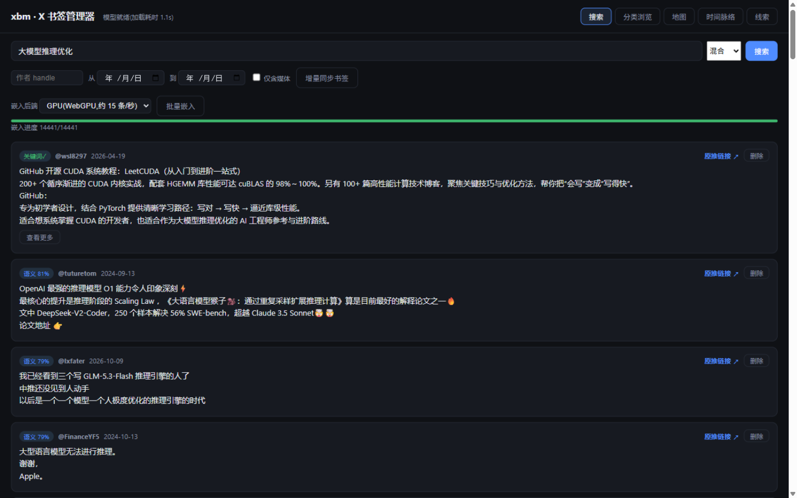
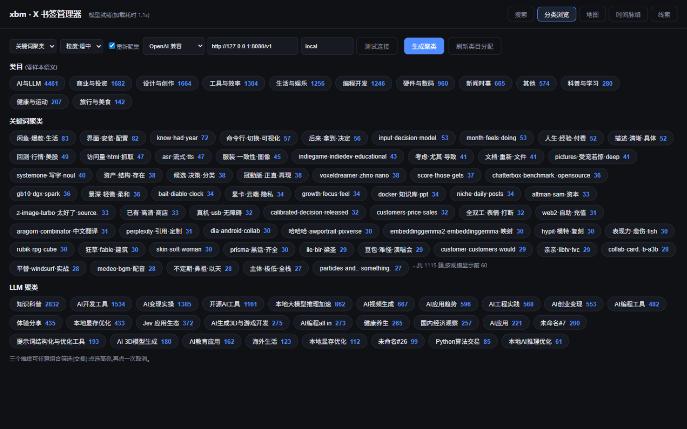
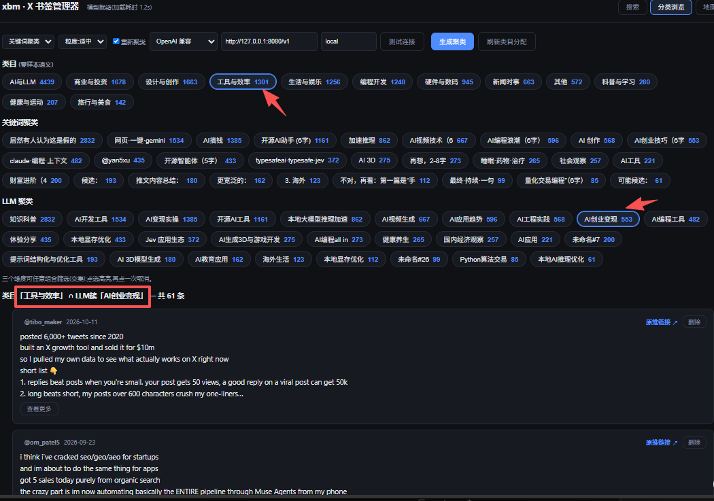
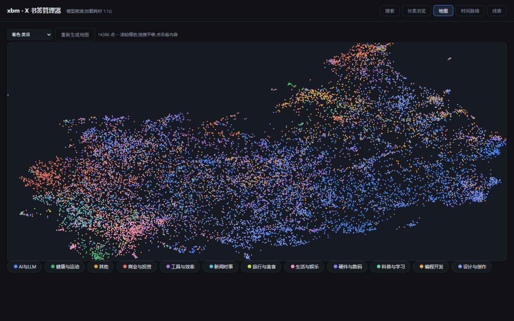
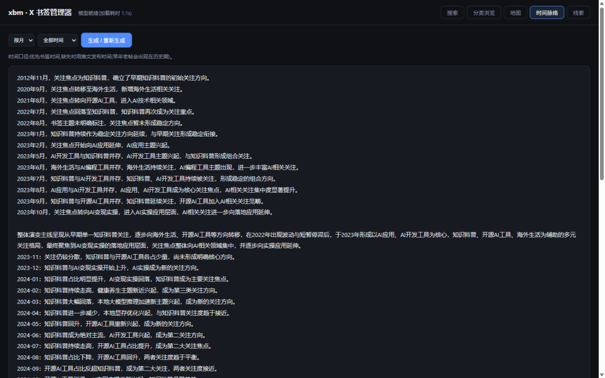
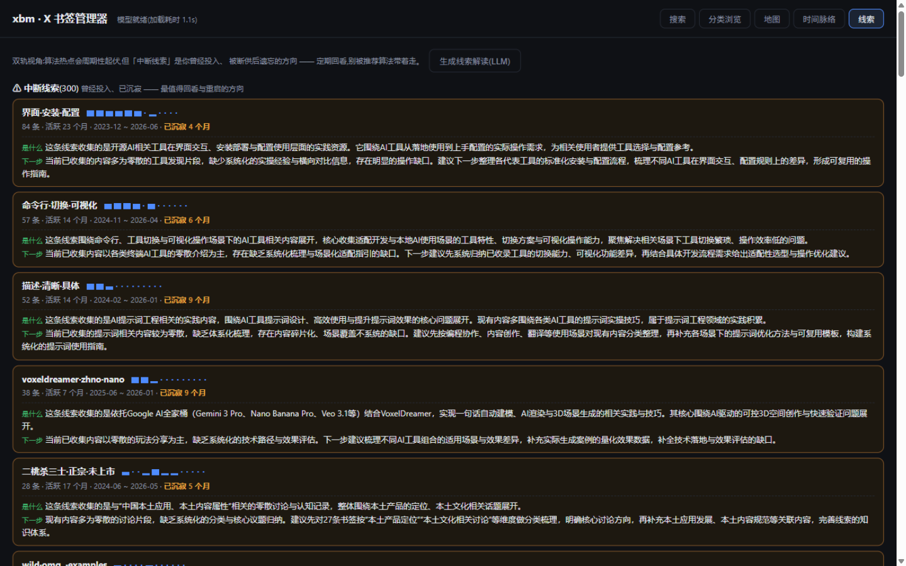
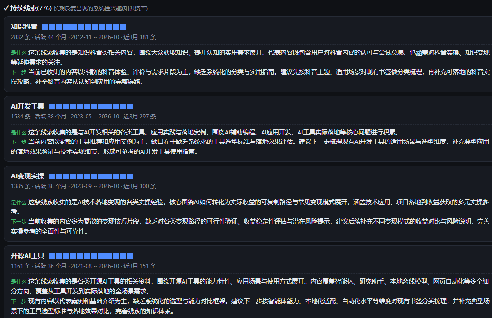

# xbm — X.com Bookmark Manager

**English version** | [中文版](README.md)

Fixes the two biggest pains of X.com bookmarks: **no semantic/fuzzy search**, and
**no content-based browsing**. All data and compute stay on your machine:
SQLite + a local embedding model (EmbeddingGemma via LiteRT-LM, in-process CPU/GPU).

```
x.com bookmarks ──(incremental sync, cookie)──> SQLite (tweets + FTS5 index + vectors)
                       │                              ↑
                       └── new bookmarks auto: embed → category/cluster assign (zero LLM)
Web UI (5 views): Search · Browse (3-dim intersection) · UMAP Map · Timeline · Interest Threads
```

> Read-only access to your own bookmarks only. Review and follow x.com's ToS at your own
> risk; on rate limits the tool waits automatically.

## Feature Tour

Screenshots below are from a real library (14,441 bookmarks / 12 categories /
1,115 keyword clusters / 27 LLM clusters / 14,386 map points).

### 1. Search — literal + semantic, fused ranking



X's native search matches literal strings only. xbm runs **both retrieval paths** and
fuses the results:

- **Keyword path** (`关键词✓` badge): FTS5 trigram full-text index; CJK matches by
  **substring** — no tokenization, no need to remember exact wording;
- **Semantic path** (`语义 81%` badge): cosine similarity from a local embedding model.
  Search "LLM inference tuning" and it recalls CUDA kernel optimization, inference
  scaling laws, and engine tuning tips — tweets that **never contain those words**;
- **Fusion**: both lists merge via RRF (k=60); a hit can carry both badges, telling you
  whether it's a literal or a semantic match.

The value: the best bookmarks are often written in words you don't remember. The
semantic path fishes them out; the keyword path keeps you precise. Author/date/media
filters included, plus Hybrid / Semantic / Keyword modes.

### 2. Browse — three orthogonal dimensions, arbitrary intersections



One folder level doesn't scale to thousands of items. xbm slices your library along
**three independent, non-overlapping dimensions**:

| Dimension | Method | Scale | Question answered |
|---|---|---|---|
| **Categories** | zero-shot semantic (category-description cosine) | 12 × all | "What kind of content is this?" |
| **Keyword clusters** | IDF-weighted word-vector leader clustering | 1,115 clusters | "Which words does it use?" |
| **LLM clusters** | embedding leader clustering + LLM naming | 27 clusters | "What is it semantically about?" |

**All three coexist.** The literal and semantic clusterings are fully independent — the
same topic never lands in the same bucket on both sides. That's the point: an
intersection means "semantically close **AND** worded alike", which narrows precisely.
Selecting a category ∩ an LLM cluster below cuts 14,441 items down to **61**:



Every narrowing step has an explicit justification and is instantly clickable. A single
tag system can only shrink results; three orthogonal dimensions answer different
questions, and combining them is real retrieval.

### 3. Map — a semantic galaxy of 14,386 bookmarks



UMAP projection (auto-falls back to numpy-PCA without umap-learn) maps every bookmark to
2D, colored by category / keyword cluster / LLM cluster.

Folders give you a **list**; the map gives you **structure**:

- Semantically close bookmarks form star clusters whose shape, size and density mirror
  your real interests and their strength;
- **Empty regions and isolated points** stand out — long-tail content the
  recommendation engine never pushed but that is semantically distinctive, often exactly
  what deserves a second read;
- Dense overlaps show repeated collecting on one topic; sparse edges show interests
  diverging — trends invisible in list views. Wheel-zoom, drag-pan, click for details,
  and switch coloring to spot where literal and semantic structures disagree.

### 4. Timeline — how your focus evolved



Per-month/quarter topic stats with an LLM-written **narrative of how your focus
evolved** (a line or two per period + an overall throughline). Revisiting old
bookmarks, what you really want to know is "how did I get here". This turns scattered
bookmarks back into a **cognitive trajectory** — from 2012 science notes, to 2020
overseas life, to the AI-tools sprout of 2021-2022, to "AI monetization in practice"
becoming the mainline after 2023 — each node says **what shifted and why**.

Periods prefer bookmark time and fall back to tweet time, so classic old posts you
bookmarked years ago still appear. Windows: all-time / last 24 months / last 12 months;
long ranges are narrated in segments so a single failure can't kill the whole run.

### 5. Threads — separating "algorithm hype" from "my knowledge assets"



The most counter-intuitive view, and the core design.

**The problem: monthly stats of bookmarks are just a mirror of the algorithm.** Whatever
the recommender pushes shows up as peaks; you see the platform's rhythm, not your
interests.

This view classifies each topic cluster by its **temporal activity profile**, with
deterministic rules:

| Class | Rule | What it's for |
|---|---|---|
| ⚠ **Dormant** | active ≥2 months, silent ≥4 months | **The deliverable**: directions you invested in, then the feed stopped supplying — revisit & restart |
| ✓ **Persistent** | ≥4 active months or ≥6-month span | systematic interests — your actual knowledge assets |
| 🌱 **Emerging** | first seen <2 months ago | evaluate whether to invest |
| ⚡ **Hype pulse** | ≤2 months of activity, then gone | recommendation-engine hype; skim and move on |

Above: **dormant threads** (300+), each with a 12-month activity sparkline showing
"was hot, now cold" — content the algorithm will never show you again but that you
once deliberately saved. Below: **persistent threads** (776) — the skeleton of your
knowledge assets ("Science explainers" active 44 months, "AI dev tools" 33 months).



Each thread can optionally get an LLM card: **what it is** and **what's missing next**
(the deterministic stats never need an LLM).

### What the five views solve together

| View | Question |
|---|---|
| Search | "I remember it, but not where" |
| Browse | "How much do I have about X, and where?" |
| Map | "What does my library look like as a whole?" |
| Timeline | "How did my focus evolve?" |
| Threads | "What deserves my attention again?" |

Each alone is a tool; together they form a loop — **search recalls, browse narrows,
map shows the whole, timeline explains change, threads decide what's next**. Bookmarks
stop being "saved and never opened" and become an asset that surfaces its own structure.

## Prepare the model (once)

Download an EmbeddingGemma `.litertlm` model file (published on HuggingFace
`litert-community` etc., e.g. `embeddinggemma-2-text-270m.litertlm`, ~160MB) into
`models/`:

```bash
mkdir models   # drop the *.litertlm here; or point XBM_MODEL_PATH at any path
```

## Quick Start

```bash
pip install -r requirements.txt

# 1. Sync credentials (once; cookies stay valid for months)
python -m xbm sync --login        # wizard: opens x.com, guides cookie copy/paste
# or:  python -m xbm sync --cookie "auth_token=...; ct0=..."

# 2. Pull bookmarks (twscrape handles endpoint rotation & rate limits)
python -m xbm sync                # incremental: stops at first known tweet

# 3. Bulk embed + auto-classify
python -m xbm embed --backend gpu # cpu ~9/s, gpu (WebGPU) ~15/s; or use the web button

# 4. Web UI (needs web/dist: from the Release asset, or build from source)
python -m xbm serve               # http://127.0.0.1:8788
```

Web frontend distribution (either way):

```bash
# Option A: download the prebuilt package from Releases (includes wasm runtime)
unzip xbm-web-dist-v0.1.0.zip -d web/dist

# Option B: build from source (needed after editing web/)
cd web && npm install && npm run build
```

The UI language follows your browser; toggle with the **EN / 中文** button in the
top-right. CLI messages follow the system locale (`XBM_LANG=zh|en` overrides).

## CLI Reference

| Command | Purpose |
|---|---|
| `sync --login / --cookie ...` | import credentials (stored in `~/.xbm/x-sync.json`, local only) |
| `sync [--full] [--limit N]` | incremental / full sync (twscrape preferred, raw fallback) |
| `search "query" [--mode auto\|fts\|vector] [--author A]` | hybrid search from the terminal |
| `report` | data-quality report (media/links/language/length distributions) |
| `import --archive archive.zip` | fallback: official archive ZIP/dir import (tolerates 3 format variants) |
| `serve [--port 8788]` | local web service (static UI + API + model streaming) |
| `embed [--backend cpu\|gpu]` | bulk embedding with the local in-process model |

## Known Limitations

- Read-only, your own bookmarks; ToS risk is yours. On HTTP 429, wait a few minutes.
- Images inside bookmarks are not semantically searched yet (OCR/multimodal possible later).
- Linked-article bodies are not fetched yet.
- WebGPU needs a recent Chrome/Edge; the page shows clear errors otherwise.

## Tests

```bash
python -m unittest tests.test_all -v   # 27 tests: archive formats / dedup / FTS /
                                       # hybrid search / both sync backends / clustering /
                                       # threads / timeline
```

## Project Layout

```
xbm/            Python package (numpy + jieba; twscrape/umap/hdbscan optional)
  sync.py       twscrape + raw GraphQL backends, --login wizard
  importer.py   unified multi-source import & dedup
  search.py     FTS + vector + RRF hybrid retrieval
  cluster.py    dual-method clustering (literal IDF / semantic embedding)
  threads.py    dormant/persistent/emerging/pulse thread analysis
  timeline.py   per-period digests + LLM narrative
  i18n.py       bilingual messages (zh/en)
web/            browser frontend (vite + @litert-lm/core; in-browser WebGPU embedding)
  src/i18n.js   zh/en UI dictionary
tests/          unit tests + synthetic archive fixtures
docs/screenshots/  UI screenshots (from real data)
```

## License

MIT — see [LICENSE](LICENSE).
